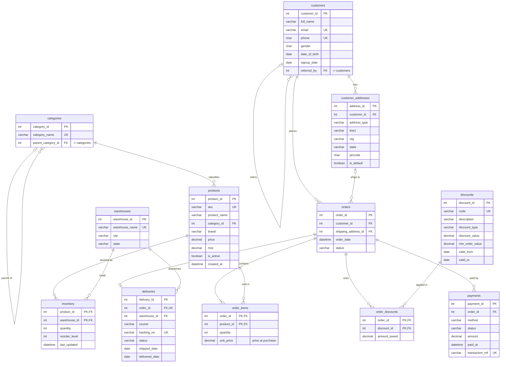

# ER Diagram — E-Commerce Order and Customer Analytics System

The diagram matches `sql/01_ddl_schema.sql` exactly: 12 tables, 15 foreign keys.

## 1. Diagram (Mermaid)

**How to read the crow's-foot symbols:** `||` means exactly one, `|o` means zero or one, `o{` means zero or many, and `|{` means one or many.

## 2. Entities

| # | Entity | Primary key | What it stores |
|---|---|---|---|
| 1 | customers | customer_id | People who shop; optional referrer |
| 2 | customer_addresses | address_id | Delivery addresses of a customer |
| 3 | categories | category_id | 3-level product category tree |
| 4 | products | product_id | Catalogue items with current price and MRP |
| 5 | warehouses | warehouse_id | Places that hold stock |
| 6 | inventory | (product_id, warehouse_id) | Stock of one product in one warehouse |
| 7 | orders | order_id | One purchase by one customer |
| 8 | order_items | (order_id, product_id) | Lines of an order, with price at purchase |
| 9 | payments | payment_id | Payment attempts for an order |
| 10 | discounts | discount_id | Coupons (percent or flat) |
| 11 | order_discounts | (order_id, discount_id) | Coupon applied to an order and amount saved |
| 12 | deliveries | delivery_id | Shipment of an order |

**Weak / associative entities:** `inventory`, `order_items` and `order_discounts` have no key of their own. Each is identified by the combination of its two parents.

## 3. Relationships and cardinality

| Relationship | Cardinality | Implemented by | ON DELETE |
|---|---|---|---|
| customer **has** addresses | 1 : N | `customer_addresses.customer_id` | CASCADE |
| customer **refers** customer (recursive) | 1 : N (optional) | `customers.referred_by` | SET NULL |
| customer **places** orders | 1 : N | `orders.customer_id` | RESTRICT |
| order **ships to** address | N : 1 (optional) | `orders(shipping_address_id, customer_id)` → `customer_addresses(address_id, customer_id)` | RESTRICT |
| category **parent of** category (recursive) | 1 : N (optional) | `categories.parent_category_id` | RESTRICT |
| category **classifies** products | 1 : N | `products.category_id` | RESTRICT |
| products **stocked in** warehouses | **M : N** → resolved by `inventory` | 2 FKs + composite PK | CASCADE |
| orders **contain** products | **M : N** → resolved by `order_items` | 2 FKs + composite PK | order: CASCADE, product: RESTRICT |
| order **paid by** payments | 1 : N | `payments.order_id` | CASCADE |
| orders **use** discounts | **M : N** → resolved by `order_discounts` | 2 FKs + composite PK | order: CASCADE, discount: RESTRICT |
| order **shipped as** delivery | **1 : 1** | `deliveries.order_id` with UNIQUE | CASCADE |
| warehouse **dispatches** deliveries | 1 : N | `deliveries.warehouse_id` | RESTRICT |

## 4. Design decisions worth explaining
- **Price at purchase.** `order_items.unit_price` keeps the price the customer actually paid, so a later change to `products.price` does not rewrite old orders.
- **No stored order total.** The total is derived as `SUM(quantity * unit_price)`. Storing it would create a redundant value that could drift out of sync with the items.
- **Composite FK for the shipping address.** An order can only ship to an address that belongs to the same customer. The database enforces this, not the application.
- **Two self-references.** `customers.referred_by` (who referred whom) and `categories.parent_category_id` (category tree). These are used for SELF JOINs and the recursive CTE.
- **1:1 delivery.** `UNIQUE(order_id)` on `deliveries` stops an order from having two shipments.
